<div align="center">

# CorroVision

### AI-based underwater corrosion detection and corrosion-type classification


[](https://colab.research.google.com/github/deem-de/CorroVision/blob/main/CorroVision_Final_Pipeline.ipynb)

**Stage 1 detection: 99.6% accuracy** &nbsp;·&nbsp; **Stage 2 type classification: 75.9%** &nbsp;·&nbsp; **End to end (9 classes): 77.8%**

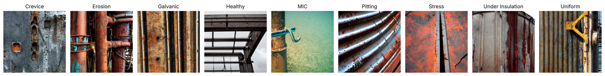

</div>

## Overview

Underwater structures such as pipelines, ship hulls and offshore platforms are inspected by divers and
video operators, which is slow, costly and hazardous. CorroVision inspects an image in two stages:

- **Stage 1 - Detection:** is the structure *Healthy* or *Corroded*?
- **Stage 2 - Type classification:** which of eight corrosion types is it?
  (crevice, erosion, galvanic, MIC, pitting, stress, under-insulation, uniform)

Four families of methods are compared on **identical test images**, from hand-designed features to
transfer learning.

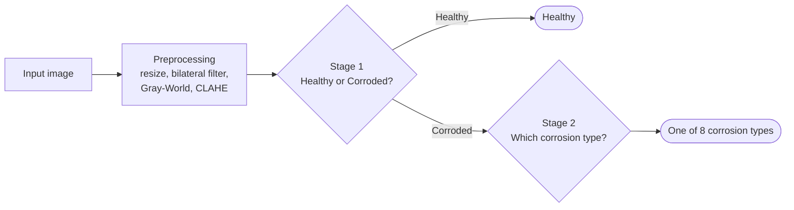

## Demo app

Upload a photo of a structure and the app tells you whether it is healthy or corroded, and which
corrosion type it most likely is.

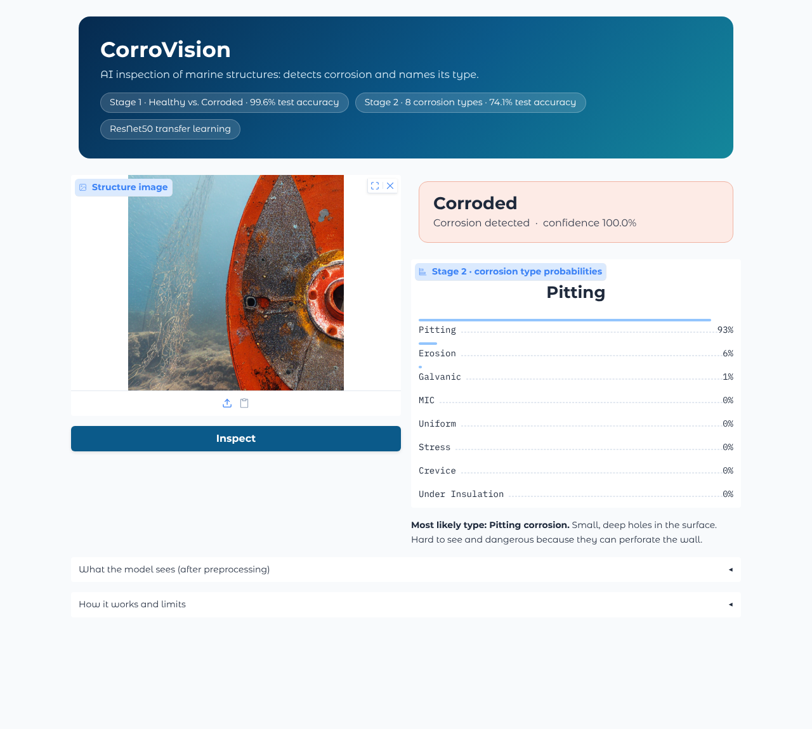

**Run it on Google Colab** (no installation): open a new notebook and run this cell, then open the
public link it prints.

```python
!git clone https://github.com/deem-de/CorroVision.git
%cd CorroVision/app
!pip -q install gradio
!python app.py --share
```

**Run it on your computer:**

```bash
git clone https://github.com/deem-de/CorroVision.git
cd CorroVision/app
pip install -r requirements.txt
python app.py
```

The app uses the frozen ResNet50 with the two classification heads trained in this project
(`app/models/`, exported by `code/08_export_heads.py`).

## Results

All numbers are measured on the held-out test split (1,349 images; Stage 2 uses its 1,199 corroded images).

| Method | Stage 1 accuracy | Healthy recall | Stage 2 accuracy | End to end (9 classes) |
| --- | :---: | :---: | :---: | :---: |
| HOG + SVM | 94.00% | 56.0% | 28.61% | 31.13% |
| GLCM + Random Forest | 92.81% | 59.3% | 35.36% | 36.92% |
| Colour-Texture + Random Forest | 95.70% | 64.7% | 45.45% | 47.37% |
| Custom CNN | 96.07% | 88.7% | 53.13% | 54.93% |
| ResNet50 (frozen) | 99.56% | 97.3% | 74.06% | 76.58% |
| ResNet50 (fine-tuned) | **99.63%** | **98.7%** | 73.89% | 76.50% |
| Fusion of 3 backbones + TTA | 99.18% | 98.0% | **75.90%** | **77.84%** |

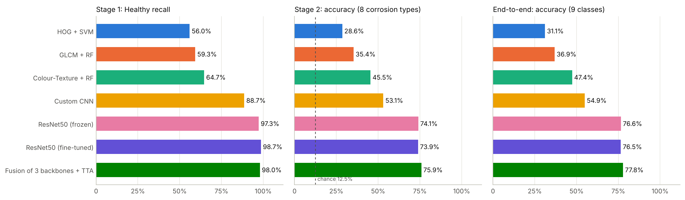

**Key findings**

- **Detection is effectively solved.** The fine-tuned ResNet50 misclassifies 5 of 1,349 test images.
- **Accuracy alone is misleading.** HOG + SVM scores 94% but finds only 56% of the healthy (minority) images.
- **Colour matters.** Adding HSV and LBP features lifts the classical Stage 2 result by 10 points.
- **Learned features win.** At Stage 2, every step from hand-designed features to a pretrained network is
  statistically significant (McNemar's exact test with Holm correction).
- **Type classification hits a ceiling near 75%.** Fine-tuning and stronger backbones gave no significant gain,
  which points to the data rather than the model.

<details>
<summary><b>More figures</b></summary>

<br>

**Stage 1 confusion matrices**

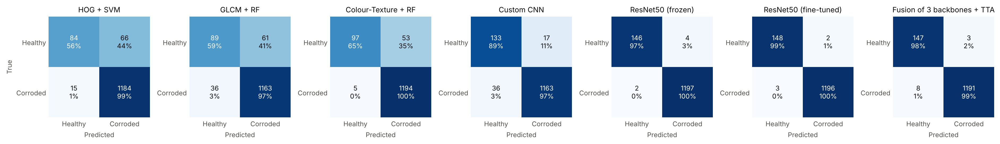

**Stage 2 recall per corrosion type**

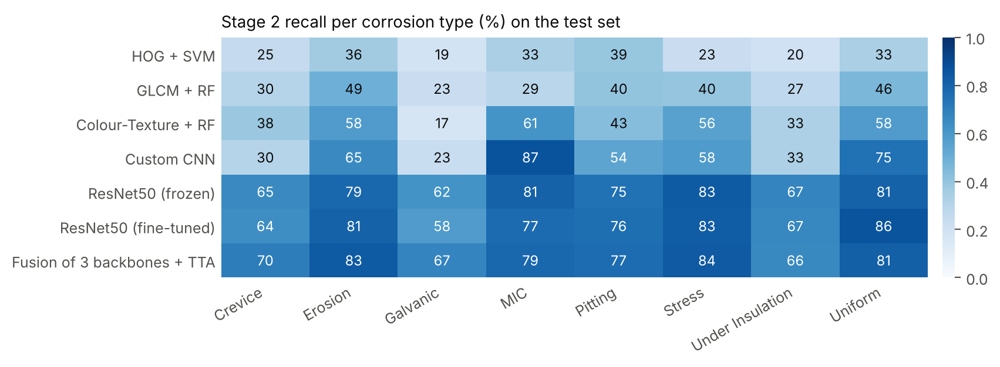

**Nine-class confusion matrix of the best pipeline**

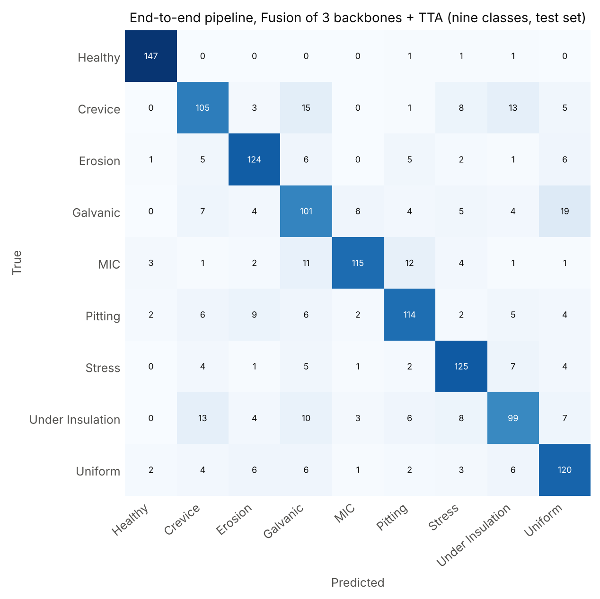

**ROC curves and threshold tuning (Stage 1)**

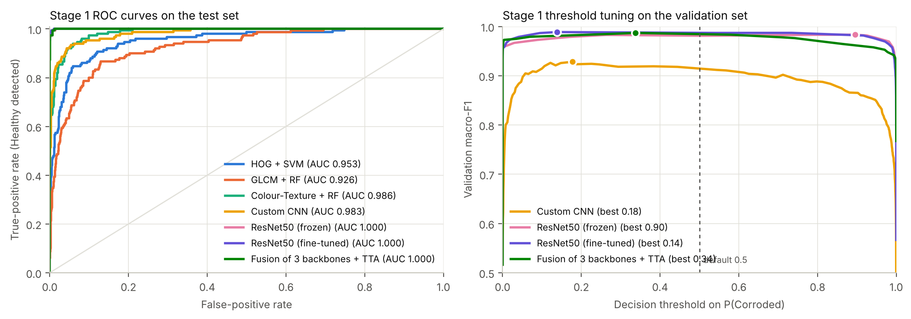

**Preprocessing steps**

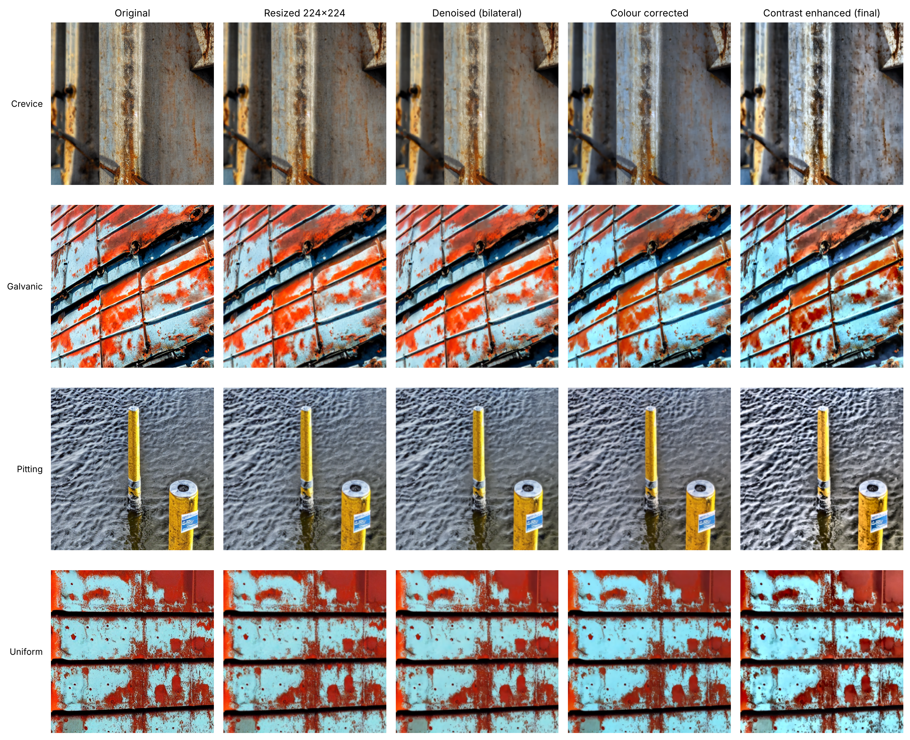

**Examples of test errors**

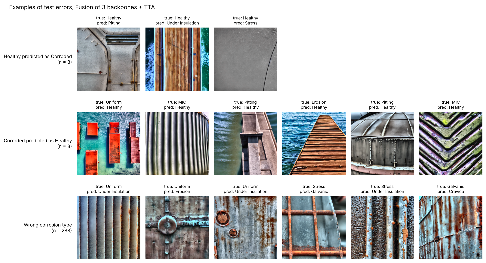

</details>

## Methods

| Method | Features | Classifier |
| --- | --- | --- |
| HOG + SVM | 6,084 edge-orientation values | RBF-kernel SVM, C = 10 |
| GLCM + Random Forest | 84 grey-level texture statistics | Random Forest |
| Colour-Texture + Random Forest | GLCM + HSV histograms + LBP (176 values) | Random Forest |
| Custom CNN | learned from scratch | 4-layer CNN (Stage 1), 7-layer separable CNN (Stage 2) |
| ResNet50 transfer learning | ImageNet features (2,048 values) | new head, then fine-tuning of conv5 |
| Backbone fusion + TTA | ResNet50 + ConvNeXt-Tiny + EfficientNetV2-S | one head on 4,096 fused features |

## Dataset

[Marine Corrosion Dataset](https://www.kaggle.com/datasets/ebrahim007/marine-corrosion-dataset) (Kaggle):
9,000 images in nine balanced classes. After removing nine blank duplicate images, 8,991 images remain,
split 70/15/15 with stratification (seed 42). Stage 1 is imbalanced, with about 1 healthy image for every 8 corroded.

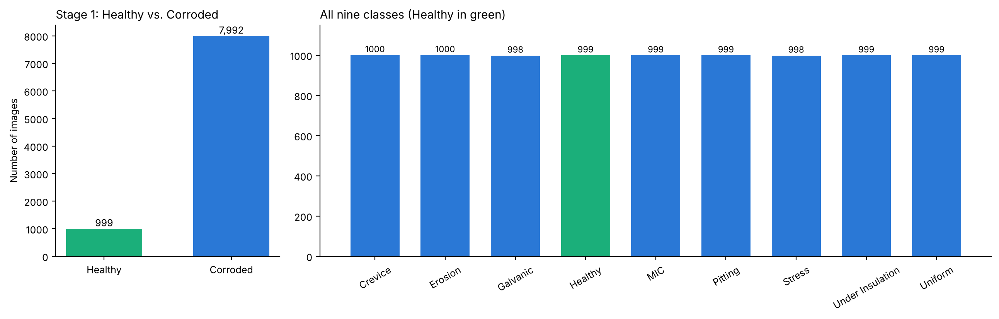

## Quick start

**Colab:** open the notebook with the badge at the top and run the cells in order.

**Local:**

```bash
pip install -r requirements.txt
export CORRO_DATA=/path/to/marine-corrosion-dataset
cd code
python 01_regenerate.py $CORRO_DATA      # rebuild processed images and features
python 06_data_figures.py $CORRO_DATA    # data figures
python 02_classical.py                   # HOG + SVM, GLCM + RF, Colour-Texture + RF
python 03_cnn.py                         # custom CNNs
python 04_transfer.py                    # ResNet50 transfer learning
python 07_backbones.py resnet50 effnetv2_s convnext_tiny   # fusion + TTA
python 05_evaluate.py                    # metrics, McNemar tests, figures
```

`inputs/` must contain `processed_images.csv`, `features_test.npz` and
`part5/best_cnn_stage1.keras` (+ `part5/cnn_test_predictions.csv`).

## Repository structure

```
CorroVision/
├── CorroVision_Final_Pipeline.ipynb   Colab notebook with all code and outputs
├── code/
│   ├── common.py                      shared settings, preprocessing, feature functions
│   ├── 01_regenerate.py               rebuild processed images and features
│   ├── 02_classical.py                HOG + SVM, GLCM + RF, Colour-Texture + RF
│   ├── 03_cnn.py                      custom CNNs
│   ├── 04_transfer.py                 ResNet50: feature extraction and fine-tuning
│   ├── 05_evaluate.py                 metrics, threshold tuning, McNemar, figures
│   ├── 06_data_figures.py             data figures
│   ├── 07_backbones.py                ConvNeXt / EfficientNetV2 features, fusion, TTA
│   └── 08_export_heads.py             export the classification heads used by the app
├── app/
│   ├── app.py                         demo app (Gradio)
│   └── models/                        the two trained classification heads
├── results/                           result tables (CSV) and figures
└── requirements.txt
```

## Notes on reproducibility

- All random seeds are fixed at 42, and every method uses the same split file.
- Random Forest results depend on the scikit-learn version; **1.6.1** is pinned.
- The Stage 2 custom CNN was stopped after 16 of 40 planned epochs (CPU training), so its result is a lower bound.
- Many images in the dataset do not look like real underwater photographs, so results may not transfer
  to real inspection footage.

## Team

CAI401 - Selected Topics 2, course project.

<!-- Add team member names here -->
